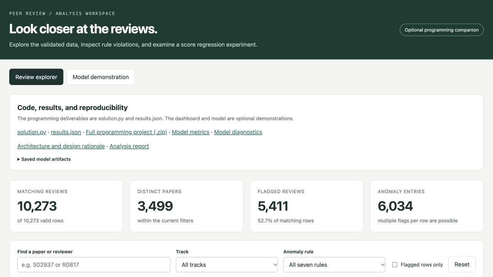
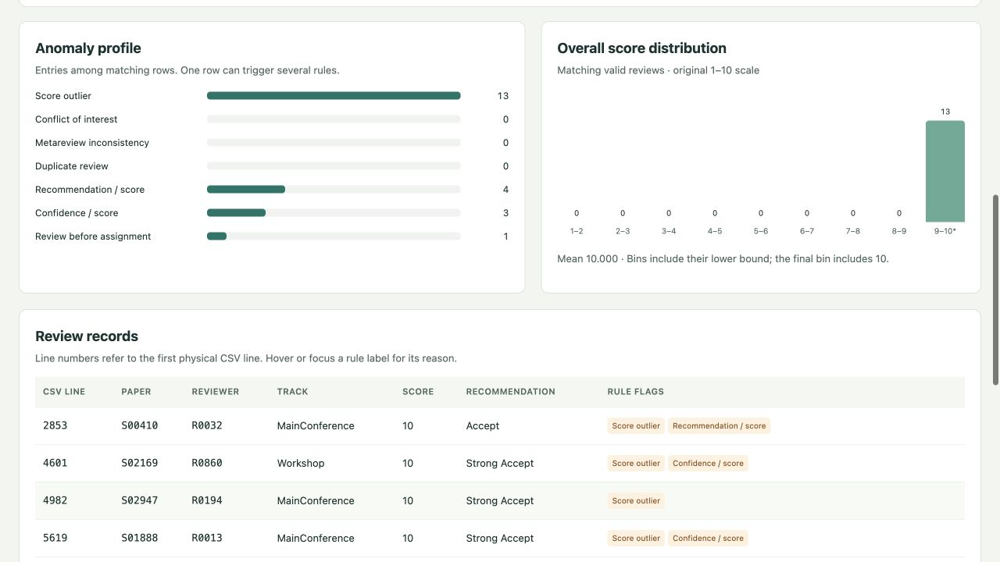
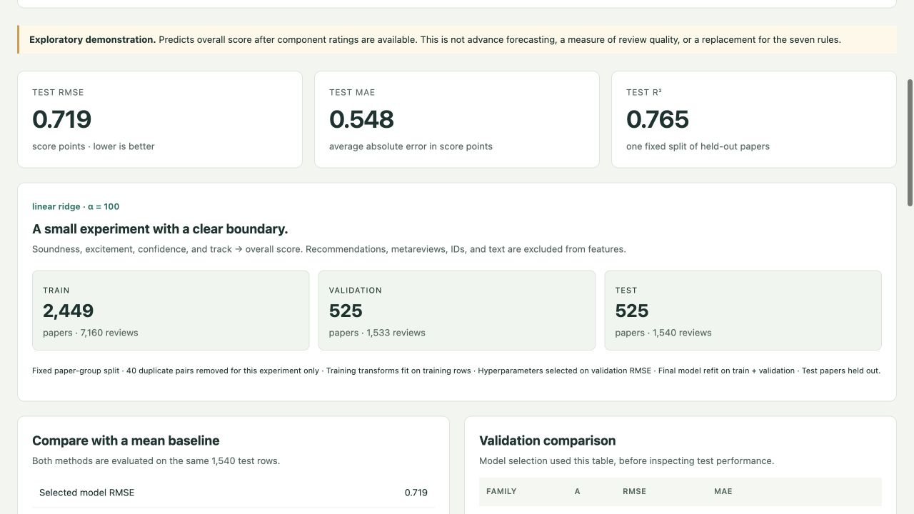

# Peer Review Analysis Pipeline

**CSV validation · Descriptive statistics · Seven anomaly rules · Interactive exploration**

A reproducible pipeline for conference review data, with a browser-based explorer and an optional score-regression experiment. The core command-line solution uses only Python's standard library and writes deterministic `results.json` output.

[**Open live dashboard**](https://ukp-peer-review-pipeline.vercel.app/) · [Quick start](#run) · [Architecture](docs/architecture.md) · [Analysis report](docs/analysis-report.md) · [Notebook](notebooks/analysis.ipynb)



### At a glance

| Valid reviews | Papers | Anomaly rules | Tests |
|---:|---:|---:|---:|
| 10,273 | 3,499 | 7 | 30 core + 19 extras |

- **Traceable data processing:** strict record validation, physical CSV line numbers, and UTC timestamp comparisons.
- **Explainable findings:** independent rule checks, deterministic results, and documented interpretation choices.
- **Interactive exploration:** filter by paper, reviewer, track, and anomaly; inspect distributions and flagged records.
- **Reproducible modeling:** paper-group splits, validation-based model selection, held-out metrics, and saved artifacts.

The counts above describe the supplied dataset. Fresh input files are processed from their contents.

## Run

```bash
python3 solution.py data/reviews.csv
```

The input may have any filename or path. The assessment's equivalent command is `python3 solution.py reviews.csv`. Upload exactly **`solution.py` and `results.json`** for the programming task.

The supplied input is available locally in `data/` and excluded from Git. On another machine, download `reviews.csv` from the [provided Drive folder](https://drive.google.com/drive/folders/1p-1kacfIDnQRmn6vzLOPq6eBOOA-EhFV) into `data/`. The task PDF can be kept locally in `references/task_instructions.pdf`; it is also excluded from Git.

## Implementation

Read the [architecture and design rationale](docs/architecture.md) for the data flow, validation contract, algorithm choices, complexity, and requirement-to-test mapping. The [analysis report](docs/analysis-report.md) explains the computed statistics, anomaly counts, optional experiment, and limits.

| Function | Responsibility |
|---|---|
| `parse_timestamp` | Parse ISO datetime values and compare UTC instants |
| `parse_review` | Validate one record and retain the fields needed downstream |
| `read_reviews` | Parse CSV quoting and track the first physical line of each record |
| `compute_statistics` | Calculate counts, means, Pearson correlation, and the population outlier limit |
| `detect_anomalies` | Count paper-level modes and evaluate all seven rules |
| `write_results` | Serialize finite JSON values and replace the output after a successful write |

The seven types are `score_outlier`, `coi_violation`, `metareview_inconsistency`, `duplicate_review`, `recommendation_score_mismatch`, `confidence_score_mismatch`, and `review_before_assignment`.

Malformed records are discarded before all statistics and anomaly checks. Valid duplicates and outliers remain included. Scores retain their original scales; missing required values are not imputed. This is a deterministic data-analysis task without a prediction model, train/test split, pickle artifact, or dashboard requirement.

## Optional extensions

### Inspect individual anomalies

The explorer links summary statistics to the underlying review rows. This view filters the supplied dataset to its 13 score outliers; additional flags on those same rows remain visible.



### Explore the regression experiment




[Open the live dashboard](https://ukp-peer-review-pipeline.vercel.app). It also provides the required files, supporting reports, and a source ZIP. [Deployment notes](docs/deployment.md) explain the static hosting setup and how to redeploy. Hosting is independent of GitHub and does not submit the assessment.

The separate [`extras/`](extras/README.md) directory adds an [offline dashboard](extras/dist/index.html), a reproducible score-regression experiment, JSON/pickle model artifacts, a prediction command, and 19 additional tests. The dashboard lets you filter the valid reviews and inspect all seven anomaly types. The experiment compares a mean baseline with linear and quadratic regression using disjoint paper groups for training, validation, and test evaluation.

These are additional portfolio materials. They do not change the required two-file submission or add dependencies to `solution.py`. Model inputs are ratings already available in a review, so this is a descriptive demonstration rather than advance forecasting. See the [experiment documentation](extras/README.md) for reproduction commands, measured results, and limitations.

Sets and counters keep duplicate and group processing linear in the number of records under normal hash-table behavior. The file is read once; a fixed number of passes over compact records computes the results. Free-text fields are not retained by the command-line pipeline.

## Walkthrough

Open [the executed notebook](notebooks/analysis.ipynb) or its [HTML view](notebooks/analysis.html). Its seven stages cover the task contract, raw CSV audit, validation and conversion, EDA, derived rule inputs, anomalies, and verification. They explain the implementation; they are not seven machine-learning stages.

The script runs without notebook dependencies. To rerun the notebook, use a Jupyter-compatible editor with Python 3.12 and the optional packages in `requirements-notebook.txt`. From the repository root:

```bash
python3.12 -m venv .venv
.venv/bin/python -m pip install -r requirements-notebook.txt
```

Select that environment as the notebook's kernel. Keep the folder layout intact and change `INPUT_CSV` in the first code cell to inspect a different file.

## Test

```bash
python3 -B -m unittest discover -s tests -v
```

The 30 test methods include 200 generated datasets compared with an independent oracle, numeric and rule boundaries, multiline CSV numbering, datetime comparisons, deterministic CLI output, and safe output replacement. The supplied-file regression is skipped if `data/reviews.csv` has not been downloaded; generated-data tests still run.

The submission implementation passed on Python 3.9.6, 3.12.14, and 3.14.6. A separate pandas/NumPy calculation matched every supplied-file statistic and anomaly pair. [Verification details](docs/verification.md) record the measured performance and limits.

## Supplied-file results

There are 10,273 valid rows from 10,548 raw records, covering 3,499 papers. The output has 6,034 anomaly entries across 5,411 rows. A row can trigger multiple rules.

| Rule | Entries |
|---|---:|
| Score outlier | 13 |
| Conflict of interest | 60 |
| Metareview inconsistency | 50 |
| Duplicate review | 40 |
| Recommendation/score mismatch | 4,863 |
| Confidence/score mismatch | 959 |
| Review before assignment | 49 |

All sample values in this section are documentation, not constants in the implementation.

## Interpretation choices

The task does not specify how to break tied metareview modes. The implementation uses the first encountered value among equally frequent modes. [The mode-tie note](docs/mode-ties.md) explains alternatives and the exact sample impact. The hidden grader's convention remains unverified.

Explicit timestamp offsets normalize to UTC; timestamps without a timezone use the input's stated UTC convention. Python's ISO parser defines the supported notation. Author membership uses exact tokens in the current row's author list.

The task does not define a JSON value for undefined Pearson correlation. Empty, singleton, or constant correlation inputs therefore produce a clear error instead of a fabricated value or nonstandard JSON `NaN`.

For syntactically broken CSV quoting, the parser discards the record it consumed. An unmatched opening quote can consume later lines; their intended record boundaries cannot be recovered unambiguously.

## Project guide

| Start here | What it contains |
|---|---|
| [`solution.py`](solution.py) | Standalone parsing, statistics, and seven-rule analysis |
| [`results.json`](results.json) | Reproducible output for the supplied dataset |
| [`tests/`](tests/) | Core parsing, statistics, boundary, and integration tests |
| [`docs/architecture.md`](docs/architecture.md) | Data flow, design decisions, and complexity |
| [`docs/analysis-report.md`](docs/analysis-report.md) | Findings, denominators, and interpretation |
| [`docs/verification.md`](docs/verification.md) | Independent checks and measured performance |
| [`notebooks/`](notebooks/) | Executed walkthrough and HTML export |
| [`extras/`](extras/README.md) | Dashboard, regression experiment, diagnostics, and model artifacts |

The source code and output are locally verified. This repository does not claim verification against UKP's inaccessible canonical grader. The separate paper review is not part of this repository.
